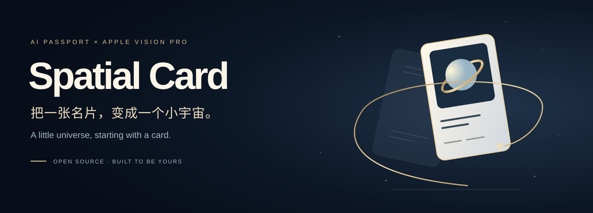
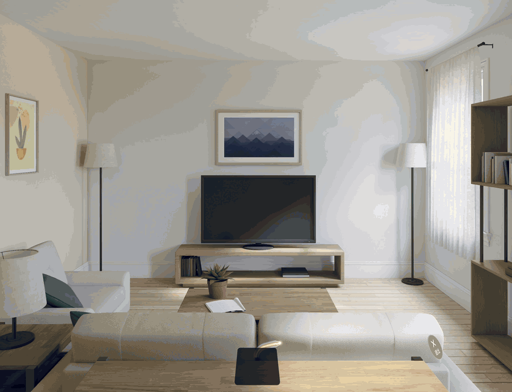
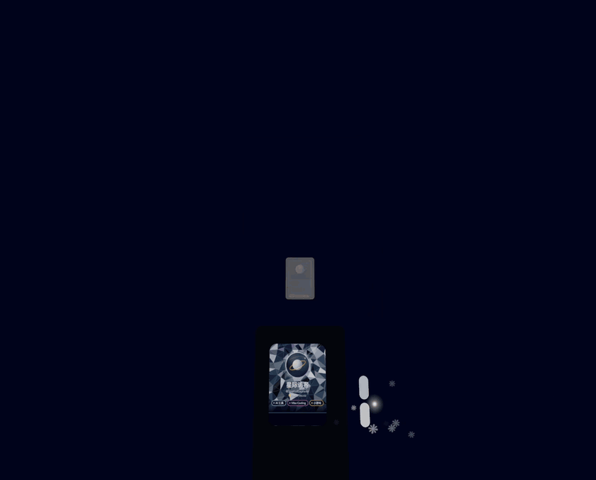

<div align="center">
  
  <p><b>Your identity, out in the world.</b></p>
  <p>AI Passport × Apple Vision Pro · a physical card, a spatial gallery, worlds to explore</p>
  <p><a href="README.md">简体中文</a> · <a href="#try-it">Get started</a> · <a href="docs/extended-model.md">Extended model</a></p>
</div>

Set an AI Passport on your desk. Put on Vision Pro. A golden ribbon draws your card into the air, and your work unfolds around it. Pick up the device and the gallery becomes a deck in your hand. Physical buttons let you browse, open a preview, or step into a neon city and a nebula.

**Spatial Card is an open source experiment you can build and make your own.** The app, firmware, sample artwork, and trained Extended object-tracking model are included.



*Captured from the public app running in the visionOS simulator with anonymous sample data and a virtual device. Real object tracking requires Vision Pro and AI Passport hardware.*

## What you can do

- **Make an entrance.** A ribbon of light, a layered portrait, and rolling numbers bring the card to life.
- **Take your work with you.** The desk gallery folds into a handheld deck; browse with physical buttons, gaze, and pinch.
- **Step into a world.** Visit the neon city or data nebula, then return through the little card that travels with you.
- **Celebrate new followers.** After connecting your own account, device sound, screen updates, and spatial effects respond together. You can also trigger a celebration from the local Hub.



## Try it

With **Node.js 24+ and pnpm 10**, try the offline control panel first:

```bash
git clone https://github.com/lhfer/ai-passport-spatial-card.git
cd ai-passport-spatial-card/hub
pnpm install --frozen-lockfile
pnpm demo
```

Open **http://localhost:8788**. Simulate five new followers, refresh the sample data, and explore the controls. Ten original sample covers are included. Demo mode requires no account, opens no serial connection, and never scrapes Xiaohongshu. Spatial effects run in the visionOS app or simulator.

To run the spatial demo without hardware, follow the [simulator instructions](docs/development.md#visionos-模拟器).

For the complete physical experience, use a FoloToy AI Passport, Apple Vision Pro on **visionOS 27+**, a Mac with an **Xcode 27 toolchain and XcodeGen**, and **ESP-IDF 5.5.3** for the firmware. Edit `assets/card/card.json`, regenerate screens with `pnpm screens`, and follow the [firmware](firmware/ai-passport-card/README.md), [Hub](hub/README.md), and [visionOS](visionos/SpatialCard/README.md) guides. Use your own signing team and account.

## The Extended model is included

The [trained reference object](visionos/SpatialCard/Resources/objects/AI-Passport-Smoked-Vibe-extended.referenceobject) downloads with the repository: approximately **7.6 MiB**, with no LFS setup. It was trained from a 3D model using Extended mode and all viewing angles. The public artifact preserves the trained model payloads and tracking geometry while removing the embedded private preview asset. See [model details and checksums](docs/extended-model.md).

Different shells, colors, or screen designs may affect tracking. Validate the model on your hardware before relying on it.

## Project map

| Directory | What lives here |
| --- | --- |
| `visionos/SpatialCard/` | SwiftUI, RealityKit, ARKit, worlds, motion, and simulator scripts |
| `firmware/ai-passport-card/` | ESP32-C3 screen, buttons, audio, BLE, and USB firmware |
| `hub/` | Local panel, data sync, cover proxy, and offline demo |
| `assets/card/` | Shared card configuration and screen generator |
| `tools/` | Original demo artwork generator and developer utilities |

## Status and contributing

This is an evolving B5 prototype. Steep viewing angles and occlusion affect tracking; particle-heavy transitions, dimming after tracking loss, and reacquisition still need work. A simulator preview cannot validate physical tracking or headset performance. See [known issues](docs/known-issues.md).

Keep your own login state and caches local. Real-device Hub mode is intended for a trusted LAN and does not include internet-facing authentication. See [security notes](SECURITY.md).

Make a card, design a new cover, build a world, or help improve the motion. Reproducible issues and focused PRs are welcome. [Contribution guide](CONTRIBUTING.md).

Original code, public demo artwork, and the bundled trained artifact are available under the **[MIT License](LICENSE)**. Third-party code and CC0 world assets retain their own terms: [notices](THIRD_PARTY_NOTICES.md).
